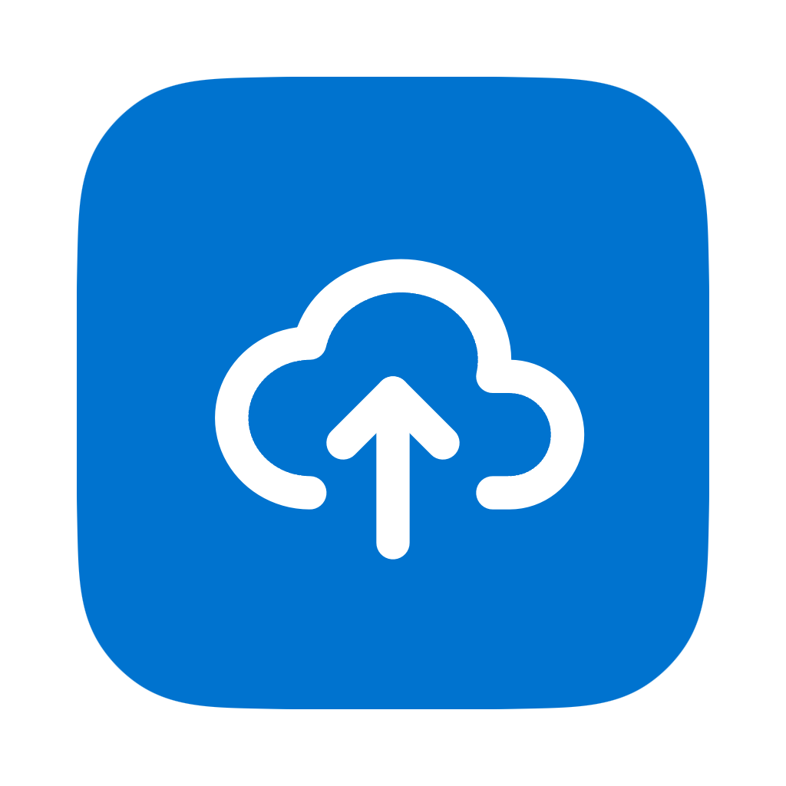
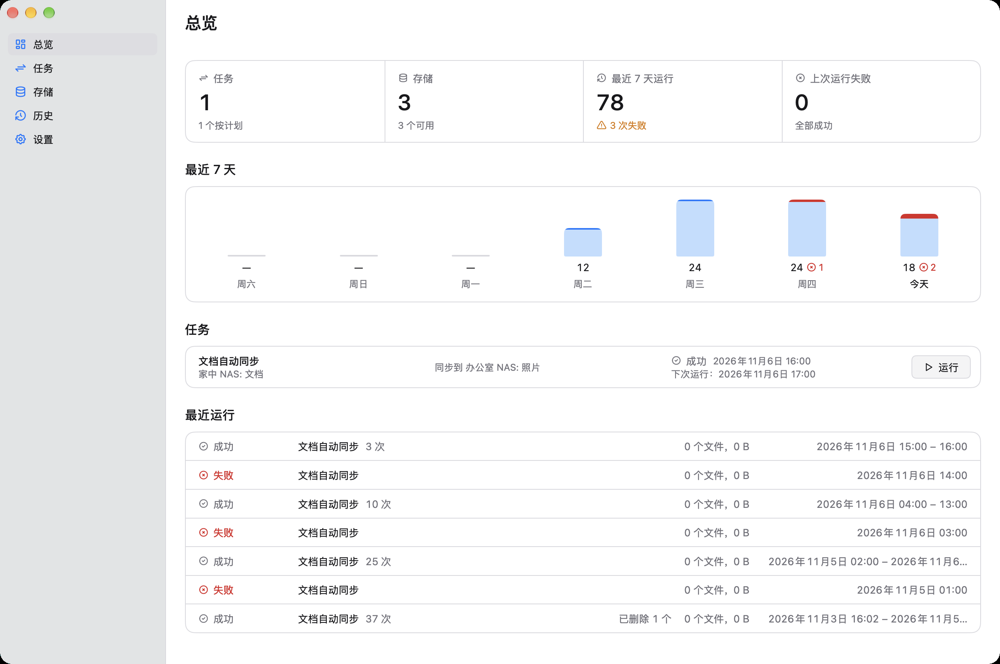
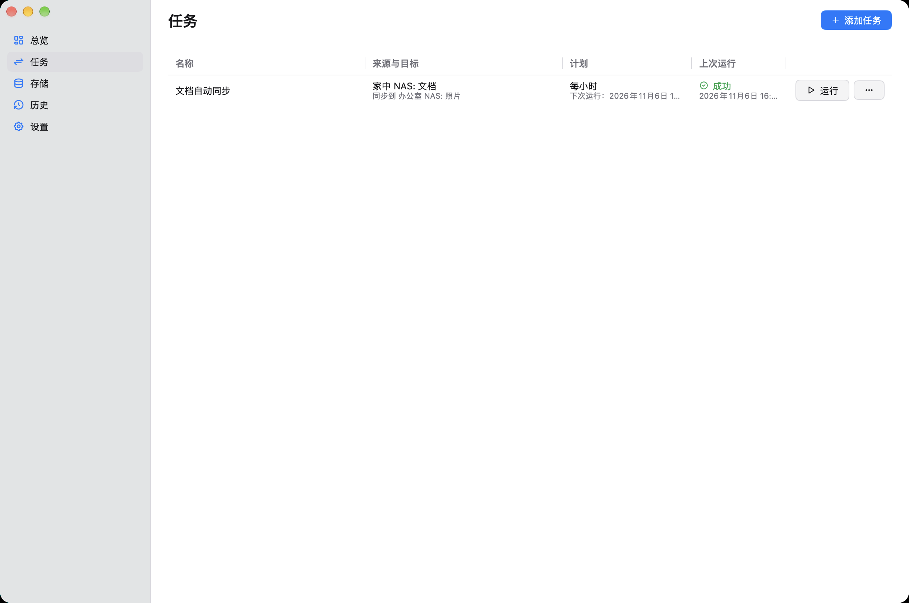
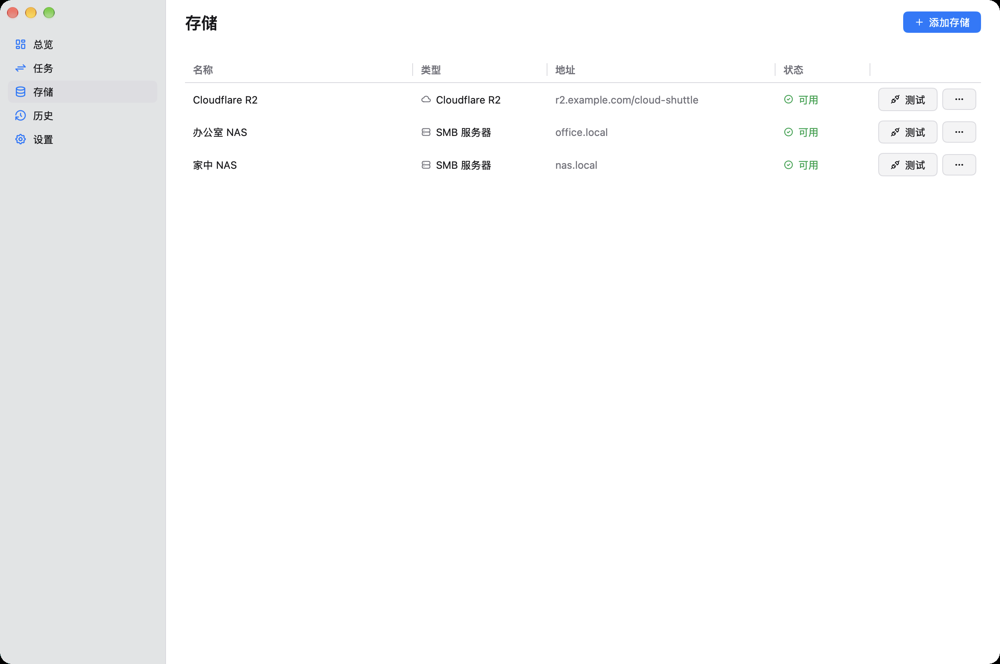
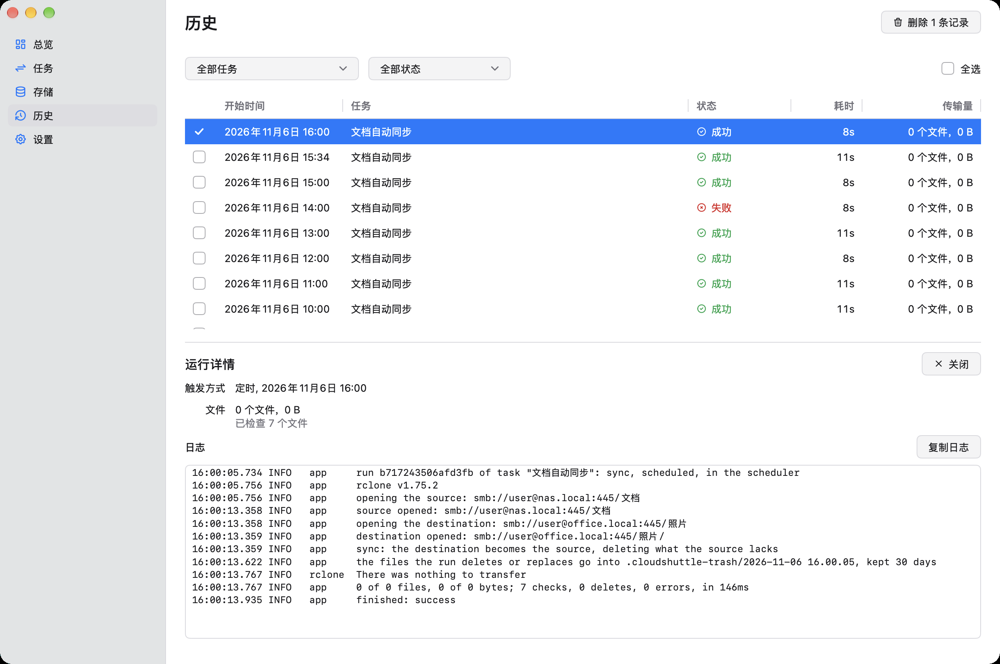
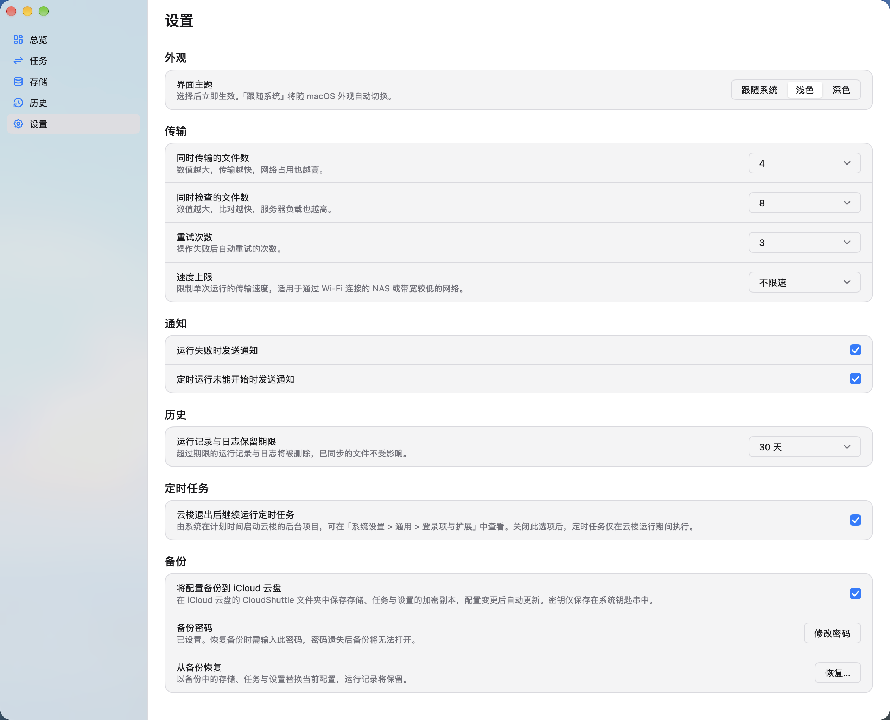

<p align="center">
  
</p>

# CloudShuttle

[简体中文](README.md) · [English](README.en.md)

[](https://awesomemygo.dev/apps/cloudshuttle)

Copy and sync files between local folders, your NAS, and cloud storage.

CloudShuttle runs quietly in the background, keeping your files in sync on your schedule. Check progress and recent results from the menu bar or system tray, and open the main window whenever you need to manage your tasks.



<table>
  <tr>
    <td width="50%"></td>
    <td width="50%"></td>
  </tr>
  <tr>
    <td align="center">Tasks</td>
    <td align="center">Storage</td>
  </tr>
  <tr>
    <td width="50%"></td>
    <td width="50%"></td>
  </tr>
  <tr>
    <td align="center">History</td>
    <td align="center">Settings</td>
  </tr>
</table>

## Highlights

- **Progress at a glance.** See task and storage counts, current progress, and recent results from the menu bar or system tray. Select a task for details. Transfers continue when you close the window.
- **Keep the app within reach.** On macOS, choose whether CloudShuttle appears in the Dock, the menu bar, or both. It defaults to the menu bar; use the icon to return to the main window after closing it.
- **Connect local folders, NAS, and cloud storage.** Use local folders, SMB shares, and S3-compatible storage, including Amazon S3, Cloudflare R2, Alibaba Cloud OSS, Tencent Cloud COS, Huawei Cloud OBS, and MinIO. CloudShuttle can also discover NAS devices on your local network.
- **Run on your schedule.** Start tasks manually or schedule them hourly, daily, weekly, or monthly. On macOS, allow background execution to keep scheduled tasks running after you quit the app. Missed tasks run when your Mac next starts up or wakes from sleep.
- **Choose copy or sync.** Copy leaves other files in the destination intact; sync makes the destination match the source. Before syncing, CloudShuttle performs a dry run. If the source is empty or the sync would delete a large number of files, it stops and lists the proposed deletions for your approval. By default, files deleted or replaced by either mode go into a trash folder in the destination and stay there for 30 days. You can set a different retention period for each task.
- **Leave out what you don't need.** Global exclusions skip development dependencies and build folders such as `node_modules`, `target`, and `.venv` by default. Review or edit the list in Settings, or restore the defaults with one click. Each task can also exclude specific files and folders, such as `.DS_Store` and `node_modules`, or skip files above a chosen size. Sync leaves excluded files in the destination untouched.
- **Review every run.** View transfer statistics and logs, and get a notification when a run fails. On macOS, live progress also appears at the top of the screen.
- **Stay informed when something goes wrong.** System notifications alert you when a run fails, a scheduled task cannot start, or a scheduled task has gone several days without a successful run.
- **Keep credentials secure.** Access keys and NAS passwords are kept in your system's credential store. On macOS, you can back up your configuration to iCloud Drive with encryption and restore it using your backup password.
- **Stay up to date.** CloudShuttle checks for updates daily by default. You can also check from Settings or the menu bar or system tray, and optionally enable automatic download and installation. Restarts wait until active tasks finish.
- **Ready to use.** No separate transfer tools to install. The native interface supports light and dark modes, follows your system appearance, and switches between English and Simplified Chinese based on your system language.

## Installation

Download the latest version from [Releases](https://github.com/starriv/cloudshuttle/releases/latest):

| File | Platform |
|---|---|
| `cloudshuttle-<version>.dmg` | macOS universal build (Intel and Apple silicon) |
| `cloudshuttle-<version>-arm64.dmg` | macOS Apple silicon (M-series) only; smaller download |
| `cloudshuttle-setup-<version>-amd64.exe` | Windows 10 / 11 (64-bit) |

### macOS

Requires macOS 12 or later. If you're unsure which Mac you have, choose the universal build.

1. Open the DMG and drag **CloudShuttle** into **Applications**.
2. Open CloudShuttle from Applications. On first launch, the main window opens so you can add storage connections and tasks. A cloud icon also appears in the menu bar.
3. On subsequent launches, CloudShuttle starts in the menu bar by default, without opening a window or showing a Dock icon. Choose **Open CloudShuttle** from the menu bar icon to open the main window. You can change where the app icon appears in **Settings > Appearance**.

The current version is not notarized by Apple. If macOS blocks it on first launch because the developer cannot be verified:

1. Click **Done** in the alert.
2. Open **System Settings > Privacy & Security**, scroll down, and click **Open Anyway**.
3. Enter your Mac login password to confirm.

You can then open the app normally. You may need to repeat these steps after an update. Alternatively, run this command in Terminal:

```sh
xattr -dr com.apple.quarantine /Applications/CloudShuttle.app
```

CloudShuttle may ask for these permissions as you set it up:

- **Local network:** Allow access when you first connect to a NAS.
- **Background execution:** When you first save a scheduled task, CloudShuttle asks whether it may run scheduled tasks after you quit the app. If you allow it, a CloudShuttle background item appears in **System Settings > General > Login Items & Extensions**.

### Windows

Run the installer and follow the prompts. The main window opens on first launch. After that, use the CloudShuttle icon in the taskbar notification area and choose **Open CloudShuttle** to open the main window.

The current version is not code-signed. If Windows displays **Windows protected your PC**, click **More info**, then **Run anyway**.

The Windows version differs from the macOS version in these ways:

- Scheduled tasks run while CloudShuttle is running. Closing the window keeps it running in the notification area; quitting the app pauses scheduled tasks.
- Encrypted backups to iCloud Drive are not available.
- Access keys and NAS passwords are kept in Windows Credential Manager.

## License

This project is licensed under the [MIT License](LICENSE). Third-party dependencies and assets remain subject to their respective licenses.
