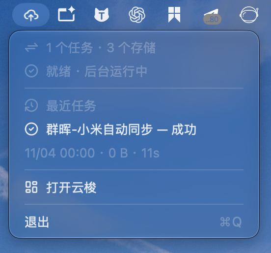
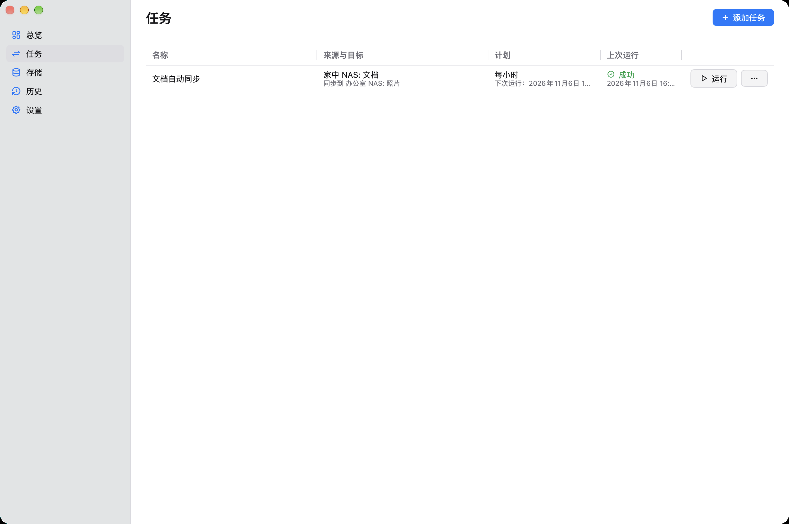
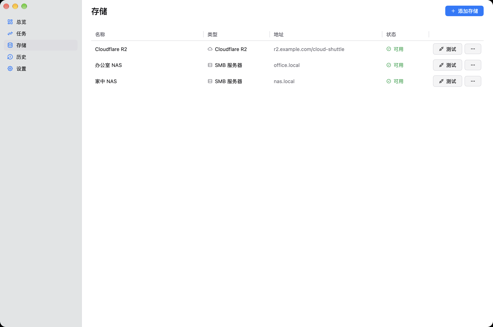
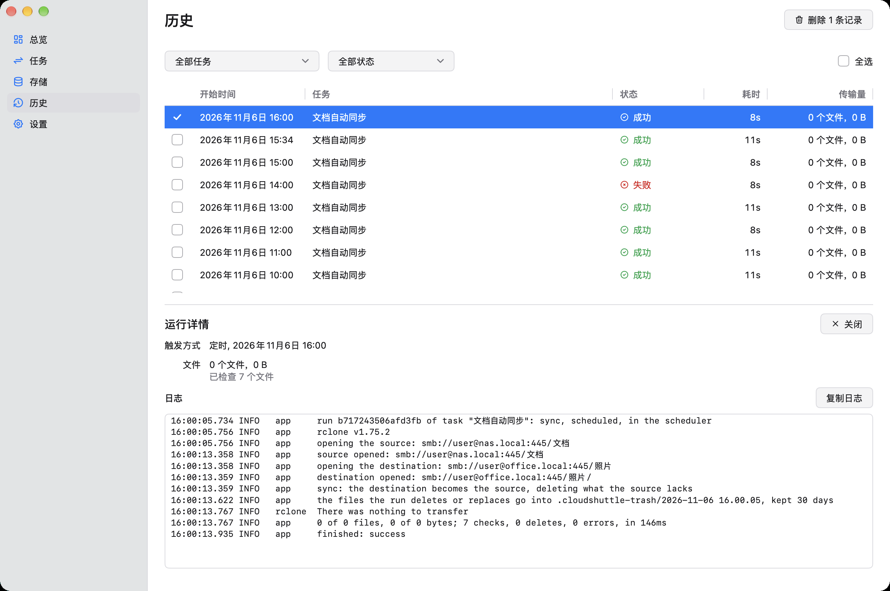
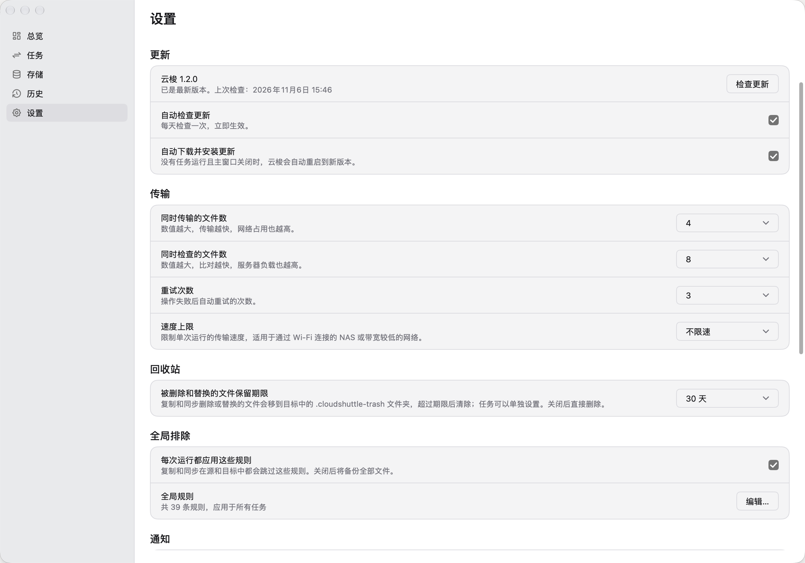

# 云梭 CloudShuttle

在本机文件夹、NAS 与云存储之间，轻松复制与同步文件。

云梭常驻状态栏，按计划在后台运行。随时查看同步进度与最近结果，需要管理任务时再打开主窗口。


<p align="center">
  
</p>
<p align="center">不打开主窗口，也能掌握同步状态。</p>

<table>
  <tr>
    <td width="50%"></td>
    <td width="50%"></td>
  </tr>
  <tr>
    <td align="center">任务</td>
    <td align="center">存储</td>
  </tr>
  <tr>
    <td width="50%"></td>
    <td width="50%"></td>
  </tr>
  <tr>
    <td align="center">历史</td>
    <td align="center">设置</td>
  </tr>
</table>

## 产品亮点

- **状态栏随时查看**：一眼看到任务与存储数量、当前进度和最近结果，点击任务即可查看详情。关闭窗口后，同步继续。
- **本机、NAS 与云端互通**：支持本机文件夹、SMB 和兼容 S3 的存储，包括 Amazon S3、Cloudflare R2、阿里云 OSS、腾讯云 COS、华为云 OBS、MinIO 等；可自动发现局域网中的 NAS。
- **按你的节奏运行**：手动启动，或按小时、天、周、月安排计划。macOS 上授权后台运行后，退出云梭也能执行定时任务，错过的计划会在开机或唤醒后补跑。
- **复制与同步，各取所需**：复制保留目标中已有的其他文件；同步让目标与来源一致。同步前先预演，发现来源为空或涉及大量删除时停止，列出将删除的文件，等你确认。复制和同步删除或替换的文件先移到目标中的回收站，默认保留 30 天，每个任务也可以单独设置。
- **排除不需要的文件**：默认全局排除 node_modules、target、.venv 这类开发依赖和构建目录，备份更轻、更快；这份清单可以在设置里查看和编辑，也能一键恢复默认。每个任务还可以排除 .DS_Store、node_modules 这类文件和文件夹，或跳过过大的文件；同步也不会删除目标里被排除的文件。
- **每次运行都有记录**：查看传输统计和日志，失败时接收通知。macOS 屏幕顶部还会显示实时进度。
- **密钥妥善保管**：访问密钥和 NAS 密码保存在系统凭据存储中。macOS 支持将配置加密备份到 iCloud 云盘，凭备份密码即可恢复。
- **自动更新**：默认每天检查新版本，也可以在设置或状态栏菜单中随时检查；可选自动下载安装。正在同步时不会打断，等任务结束后再重启。
- **装好就能用**：无需额外安装传输工具。原生界面支持浅色、深色及跟随系统外观，中英文随系统语言切换。

## 安装

从 [Releases](https://github.com/starriv/cloudshuttle/releases/latest) 下载最新版本：

| 文件 | 适用系统 |
|---|---|
| `cloudshuttle-<版本>.dmg` | macOS 通用版（Intel 与 Apple 芯片） |
| `cloudshuttle-<版本>-arm64.dmg` | macOS Apple 芯片（M 系列）专用版，体积更小 |
| `cloudshuttle-setup-<版本>-amd64.exe` | Windows 10 / 11（64 位） |

### macOS

系统要求：macOS 12 或更高版本。不确定机型时，请下载通用版。

1. 打开 DMG，将「CloudShuttle」拖入「应用程序」文件夹。
2. 在「应用程序」中双击打开云梭：第一次打开时会直接打开主窗口，从添加存储和任务开始；菜单栏同时出现云朵图标。
3. 之后启动默认不弹出主窗口，也不显示 Dock 图标；点菜单栏图标，选择「打开云梭」进入主界面。

当前版本尚未经过 Apple 公证，首次打开时系统会提示「无法验证开发者」。请按以下步骤放行：

1. 在提示框中点「完成」。
2. 打开「系统设置 > 隐私与安全性」，在页面下方点「仍要打开」。
3. 输入登录密码确认。

完成后即可正常打开；更新版本时可能需要再次放行。也可在终端执行：

```sh
xattr -dr com.apple.quarantine /Applications/CloudShuttle.app
```

首次使用时的系统授权：

- **本地网络**：首次连接 NAS 时，请允许云梭访问本地网络。
- **后台运行**：首次保存定时任务时，云梭会询问是否允许在退出后继续运行定时任务。允许后，「系统设置 > 通用 > 登录项与扩展」中将出现云梭的后台项目。

### Windows

运行安装程序，按提示完成安装。首次启动时会直接打开主窗口；之后在任务栏通知区域找到云梭图标，选择「打开云梭」进入主界面。

当前版本尚未进行代码签名，运行安装程序时可能出现「Windows 已保护你的电脑」提示。请点「更多信息」，再点「仍要运行」。

Windows 版与 macOS 版的差异：

- 定时任务在云梭运行期间执行；关闭窗口后云梭在通知区域继续运行，退出后定时任务暂停。
- 不提供 iCloud 加密备份。
- 访问密钥与 NAS 密码保存在 Windows 凭据管理器中。
